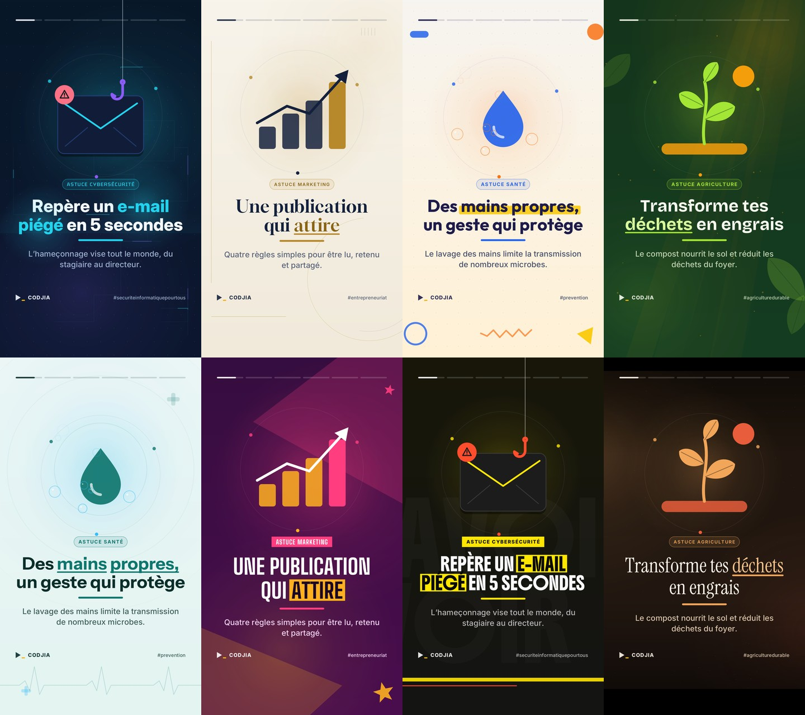
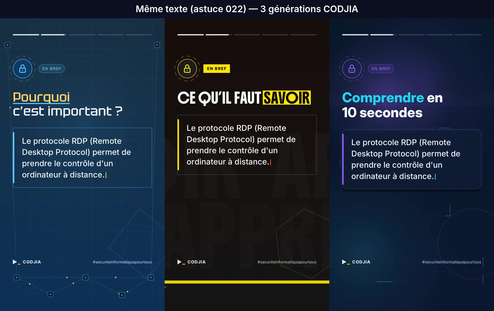

# CODJIA — prototype du moteur vidéo

CODJIA transforme **ton propre texte** en vidéo éducative verticale de 40 s au plus (MP4, H.264 et AAC), entièrement hors ligne.

- **Domaines :** réseaux (CCNA, CCNP), systèmes (Windows, macOS, Linux, Android), cybersécurité, IA, développement fullstack, santé et longévité, marketing, anglais.
- **Une vidéo différente à chaque génération :** template, mise en page, ordre, couleurs, transitions et musique varient.
- **Aucune permission :** pas de réseau, pas de collecte.

La licence est GPL-3.0-or-later.

| Module | Rôle |
| --- | --- |
| `engine-core` | Moteur Kotlin pur : chronologie, animations, transitions, texte, 10 templates, planificateur texte → storyboard, variation, musique, détection du domaine, règles de sécurité |
| `engine-jvm` | Banc d'essai (tests, captures, vidéo de démonstration) |
| `engine-android` | Rendu Canvas, export Media3 Transformer, décodage audio, catalogue musical |
| `demo-app` | Application de test : contenu → modèle → musique → aperçu → génération |
| `tools/music` | Compositions musicales originales, reproductibles |

## Télécharger

La dernière version signée est sur la page [**Releases**](https://github.com/Mensan2024/itmentor-video-prototype/releases/latest) (fichier `CODJIA-x.y.z.apk`, Android 8 ou plus). Chaque APK est accompagné de son empreinte SHA-256 et d'une attestation de provenance. La vérification est expliquée dans [docs/PUBLIER.md](docs/PUBLIER.md#5-vérifier-un-apk-téléchargé-pour-toi-et-tes-utilisateurs).

Confidentialité : [PRIVACY.md](PRIVACY.md) (aucune donnée collectée). Historique : [CHANGELOG.md](CHANGELOG.md).

## Version de test (développeurs)

Chaque envoi sur GitHub produit une version de test, **CODJIA test**, installable à côté de la version publique. Pour la récupérer : onglet **Actions**, dernière exécution verte, artefact **CODJIA-prototype-apk**.

## Documentation

- [Audit et versions conservées](docs/AUDIT.md)
- [Documentation technique](docs/DOCUMENTATION_TECHNIQUE.md)
- [Bibliothèque musicale et licences](docs/MUSIQUE.md)
- [Rapport de validation](docs/RAPPORT_VALIDATION.md)
- [Plan de développement complet](docs/PLAN_DEVELOPPEMENT.md)
- [Sécurité : modèle de menaces](docs/SECURITE.md) · [Signaler une vulnérabilité](SECURITY.md)

## Licences

- **Code et musiques :** GPL-3.0-or-later.
- **Polices :** SIL Open Font License 1.1. Les licences sont dans `engine-android/src/main/assets/fonts/`.
